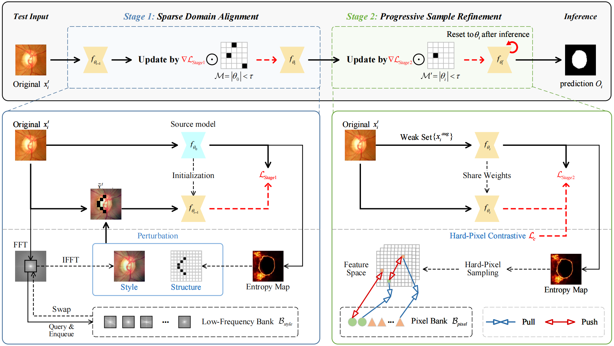

# 📄 TACT

This is the official PyTorch implementation of our CVPR 2026 Findings paper "[Wake the Sleeping Weights: Sparsely-Activated Continual Test-Time Adaptation for Medical Image Segmentation](https://openaccess.thecvf.com/content/CVPR2026F/html/Ji_Wake_the_Sleeping_Weights_Sparsely-Activated_Continual_Test-Time_Adaptation_for_Medical_CVPRF_2026_paper.html)".

<div align="center">
  
</div>

## Environment

```text
CUDA 11.8
Python 3.9.7
PyTorch 2.2.2
torchvision 0.17.2
torchaudio 2.2.2
```

Create the environment and install the dependencies from the repository root:

```bash
conda create -n TACT python=3.9.7
conda activate TACT
conda install pytorch==2.2.2 torchvision==0.17.2 torchaudio==2.2.2 pytorch-cuda=11.8 -c pytorch -c nvidia
pip install -r requirements.txt
```

## Data Preparation

The preprocessed OD/OC and polyp data can be downloaded from the [Google Drive](https://drive.google.com/drive/folders/1axgu3-65un-wA_1OH-tQIUIEHEDrnS_-?usp=drive_link) provided by [VPTTA](https://github.com/Chen-Ziyang/VPTTA).

For prostate segmentation, we use the data preprocessed by [SynFoC](https://github.com/MQinghe/SynFoC) and generate the corresponding CSV files. Our prepared data and CSV files can be downloaded from [Google Drive](https://drive.google.com/file/d/1b1qsZ5ZkkbSDD8VBYV8As8RsMYVeQQv-/view?usp=sharing).

## Pre-trained Models

Download the pretrained backbone weights and source models from [Google Drive](https://drive.google.com/drive/folders/1d-Z9ts73Cc7mEuMRMnwmDZrBdt7sFTja?usp=sharing), and set `--model_root` to the corresponding source model directory. The source checkpoints should be placed at `<model_root>/<Source_Dataset>/last-Res_Unet.pth`.

Please modify the pretrained weight paths in `OPTIC/networks/resnet.py` (line 8) and `OPTIC/networks/segformer/backbone.py` (line 494). For prostate and polyp source training, also modify line 8 in `Prostate/networks/resnet.py` and `polyp/networks/resnet.py`.

You can also train your own source models using the scripts in each folder:

```bash
# OD/OC Segmentation
bash OPTIC/train_source.sh
# Prostate Segmentation
bash Prostate/train_source.sh
# Polyp Segmentation
bash polyp/train_source.sh
# OD/OC Segmentation with SegFormer-B0
bash OPTIC/segformer_train_source.sh
```

## How to Run

Please first modify the Python interpreter, code, dataset, model, and output paths in the shell scripts and Python entry points according to your local setup. Replace the old `CTTAKAN` interpreter path with `python` after activating `TACT`. When training your own source models, set `--path_save_model` to the same directory used by `--model_root` for evaluation. Run the following commands from the repository root.

**Source Only**

```bash
# OD/OC Segmentation
bash OPTIC/baseline_only_source.sh
# Prostate Segmentation
bash Prostate/baseline_only_source.sh
# Polyp Segmentation
bash polyp/baseline_only_source.sh
# OD/OC Segmentation with SegFormer-B0
bash OPTIC/segformer_baseline_only_source.sh
```

**TACT**

```bash
# OD/OC Segmentation
bash OPTIC/TACT.sh
# Prostate Segmentation
bash Prostate/TACT.sh
# Polyp Segmentation
bash polyp/TACT.sh
# OD/OC Segmentation with SegFormer-B0
bash OPTIC/segformer_TACT.sh
```

## Citation ✏️

If this code is helpful for your research, please cite:

```bibtex
@InProceedings{Ji_2026_CVPR,
    author    = {Ji, Jianhang and Cheng, Zhiming and Zhao, Jianxiang and Ma, Bingtao and Chen, Hao and Gao, Yuhan and Zhang, Lian and Ying, Zuobin and Wang, Shuai},
    title     = {Wake the Sleeping Weights: Sparsely-Activated Continual Test-Time Adaptation for Medical Image Segmentation},
    booktitle = {Proceedings of the IEEE/CVF Conference on Computer Vision and Pattern Recognition (CVPR) Findings},
    month     = {June},
    year      = {2026},
    pages     = {7799-7809}
}
```

## Acknowledgement

Parts of the code are based on the PyTorch implementations of [VPTTA](https://github.com/Chen-Ziyang/VPTTA) and [SaRA](https://github.com/sjtuplayer/SaRA). We also thank [SynFoC](https://github.com/MQinghe/SynFoC) for providing the preprocessed prostate data.

## Contact

Jianhang Ji (jijianhang.ai@gmail.com)
